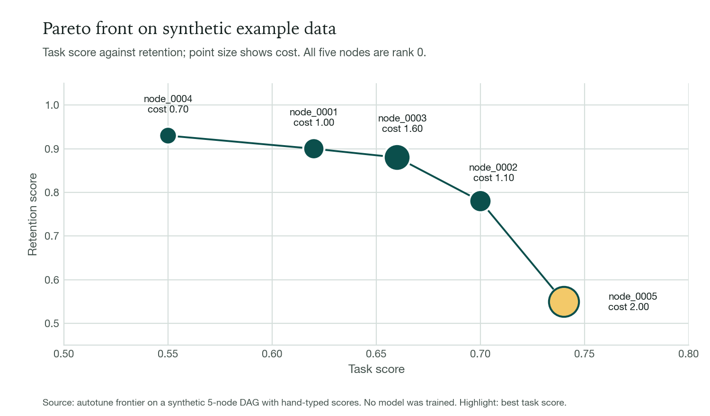
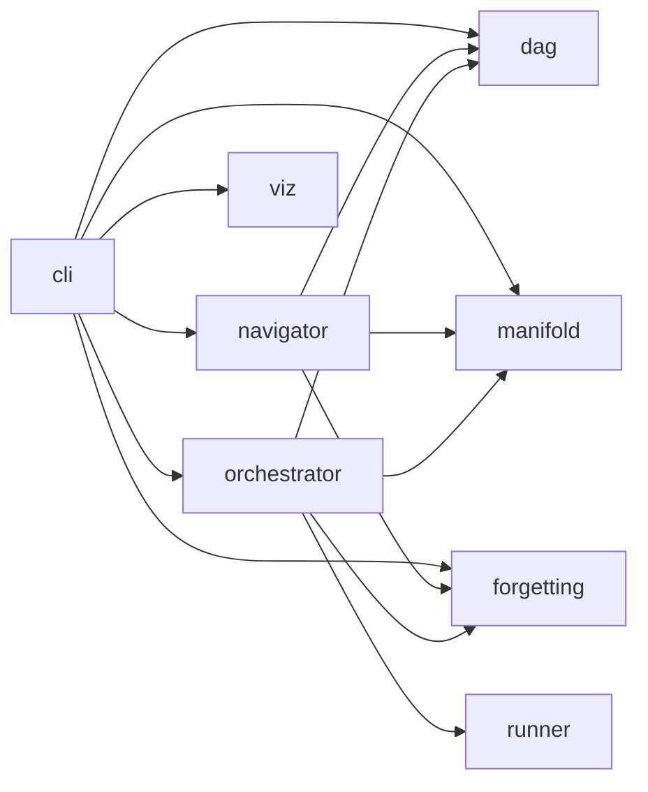

# autoTune

A command-line framework that lets a coding agent run finetuning experiments as a graph of checkpoints, ranked on task score, retention and cost.



*The `autotune frontier` output from a throwaway project with hand-typed scores. The data is synthetic: no model was trained and the numbers say nothing about autoTune's quality.*

## What it does

- Tracks experiments as a directed acyclic graph. A new experiment is a branch from one parent or a merge of several (`dag.py`).
- Ranks experiments with an NSGA-II-style Pareto sort over task score, retention and cost, and scores candidate parents with a UCB rule (`dag.py`). `autotune suggest` proposes branch and merge moves from those scores (`navigator.py`).
- Learns hyperparameter correlations with a covariance estimate and proposes moves along its principal components (`manifold.py`).
- Detects retention drops between parent and child (forgetting cliffs), records them as danger zones and skips proposals inside them (`forgetting.py`).
- Runs your training script for each queued experiment in a git worktree, collects its `result.json`, and promotes or discards the node (`orchestrator.py`, `runner.py`).

## Quickstart

Prerequisites: macOS or Linux, Python 3.11 or later (tested on 3.12), [uv](https://docs.astral.sh/uv/), git. There is no lockfile, so install from `pyproject.toml`.

```bash
git clone https://github.com/shifosss/autoTune.git
cd autoTune
uv venv --python 3.12 .venv
uv pip install -e ".[dev]"
source .venv/bin/activate

# Optional, for merge and graft moves on real checkpoints (resolves; not exercised, see Status)
uv pip install -e ".[dev,torch,safetensors,peft]"

uv run pytest -q          # 155 passed
```

Run `autotune` inside the git repository of the ML project you want to tune. The session below is **synthetic**: a throwaway git repo, hand-typed scores, and a fake `train.py` that writes a canned `result.json`. No model was trained.

```
$ autotune init --base-model example/base-model
autoTune initialized.

$ autotune suggest --n 3          # before any seed
Error: No DAG found. Submit seed experiments first.

$ autotune submit --desc "baseline LoRA" \
    --theta '{"lr":2e-4,"rank":16,"alpha":32,"dropout":0.1,"warmup_ratio":0.05}' \
    --task-score 0.62 --retention-score 0.90 --cost 1.0 --composite 0.70
Seed registered: node_0001 (composite=0.7000)

$ autotune status                 # after five seeds in total
Queue: 0 pending
Completed: 0 awaiting reconcile
Executed: 5
Proposed: 0
Best composite: 0.7400 (node_0003)

$ autotune suggest --n 3
Move suggestions (top 3):

1. MERGE from node_0003, node_0005 (score: 0.750)
   Direction: merge node_0003+node_0005
   Reasoning: diversity=1.41, node_0003 task=0.660 ret=0.880, node_0005 task=0.740 ret=0.550

2. MERGE from node_0002, node_0003 (score: 0.745)
   Direction: merge node_0002+node_0003
   Reasoning: diversity=0.59, node_0002 task=0.700 ret=0.780, node_0003 task=0.660 ret=0.880

3. MERGE from node_0001, node_0005 (score: 0.742)
   Direction: merge node_0001+node_0005
   Reasoning: diversity=1.61, node_0001 task=0.620 ret=0.900, node_0005 task=0.740 ret=0.550

$ autotune frontier
Pareto front (rank 0-1 nodes):

  node_0003: task=0.660, ret=0.880, cost=1.60, rank=0
  node_0002: task=0.700, ret=0.780, cost=1.10, rank=0
  node_0001: task=0.620, ret=0.900, cost=1.00, rank=0
  node_0005: task=0.740, ret=0.550, cost=2.00, rank=0
  node_0004: task=0.550, ret=0.930, cost=0.70, rank=0

$ autotune propose --parents node_0003 --move branch --desc "rank 32, lr 3e-4" \
    --theta '{"lr":3e-4,"rank":32,"alpha":64,"dropout":0.1,"warmup_ratio":0.05}'
Proposed: node_0007 (branch from node_0003)

$ autotune check
All checks passed.
```

Other commands: `explain`, `rank`, `reconcile`, `checkpoints`, `orchestrator start|stop|status`, `viz start|stop|status`.

## How it works



`cli.py` is the entry point. `dag.py` holds the experiment graph, the Pareto ranking and the reconcile step. `navigator.py` combines DAG scores, the manifold and the danger zones into move suggestions. `orchestrator.py` schedules queued experiments and uses `runner.py` for git worktrees and checkpoint branch, merge and graft. `viz/` is an aiohttp server with a 3D graph dashboard.

The agent drives the loop through the CLI: observe (`status`, `reconcile`), analyze (`explain`, `frontier`, `suggest`), decide, implement (edit the training script or config), submit (`propose`, `submit`), then record insights in `learnings.md`. autoTune never creates training scripts. Your script:

1. reads the parent checkpoint from `AUTOTUNE_PARENT_CHECKPOINT`;
2. writes its checkpoint to `AUTOTUNE_CHECKPOINT_DIR`;
3. writes `result.json` to its working directory, with `"checkpoint_saved": true` if the checkpoint should be kept (`orchestrator.py:489`).

The orchestrator also sets `AUTOTUNE_GPU`, `AUTOTUNE_NODE_ID` and `AUTOTUNE_MOVE_TYPE`. It does not pass hyperparameters (`theta`) to the script; it archives `spec.json` only (`orchestrator.py:320`), so the agent applies `theta` by editing code or config. The full contract is in [`docs/workflow-reference.md`](docs/workflow-reference.md).

## Status and limits

- **No benchmark.** There is no published benchmark, no comparison against random search or another tuner, and no result in this repo showing a finetuned model improving. The numbers above are synthetic. The end-to-end flow was run only against a fake training script.
- **Merge and graft are tested only on fake state dicts** (`tests/test_runner.py`). They were never run on real checkpoints. Both need `torch`; without it a merge node is marked crashed.
- **The manifold is custom, not CMA-ES.** It is an exponential-moving-average covariance update with an eigendecomposition in NumPy (`manifold.py`). It stays at identity until 10 evaluated points exist, and only the orchestrator updates it: after 12 seeds registered with `autotune submit`, `autotune explain` still reports that the manifold is not learned. The "parameter importance" percentages do not sum to 100% (206.8% in one run); read them as relative.
- **Optuna is declared but unused.** It is listed in `pyproject.toml` and not imported anywhere in `src/` or `tests/`. `peft` is only a config field name in `runner.py`, never imported.
- **Retention is opt-in** (`retention.enabled: false` in the config template). Forgetting-cliff detection is covered by unit tests but was not triggered in an end-to-end run.
- **The dashboard needs internet.** `autotune viz start` serves a page that loads d3, three.js, 3d-force-graph and plotly from `cdn.jsdelivr.net`. The dashboard was not launched during verification; its 15 tests pass.
- **CI does not pass today.** The GitHub Actions workflow targets Python 3.10 while the package requires 3.11 or later, and it installs only `flake8` and `pytest`, never the package.
- **Tests and lint.** 155 tests pass. Line coverage is 72% overall, with 52% in `orchestrator.py` and 38% in `viz/server.py`. `ruff check src/ tests/` reports 26 errors and `ruff format --check` flags 3 files (ruff 0.17.4).
- **Rough edges.** `autotune status` can print `Recommend: merge merge node_...`, and its `Proposed:` count never decreases.

## License

AGPL-3.0, see [`LICENSE`](LICENSE).
